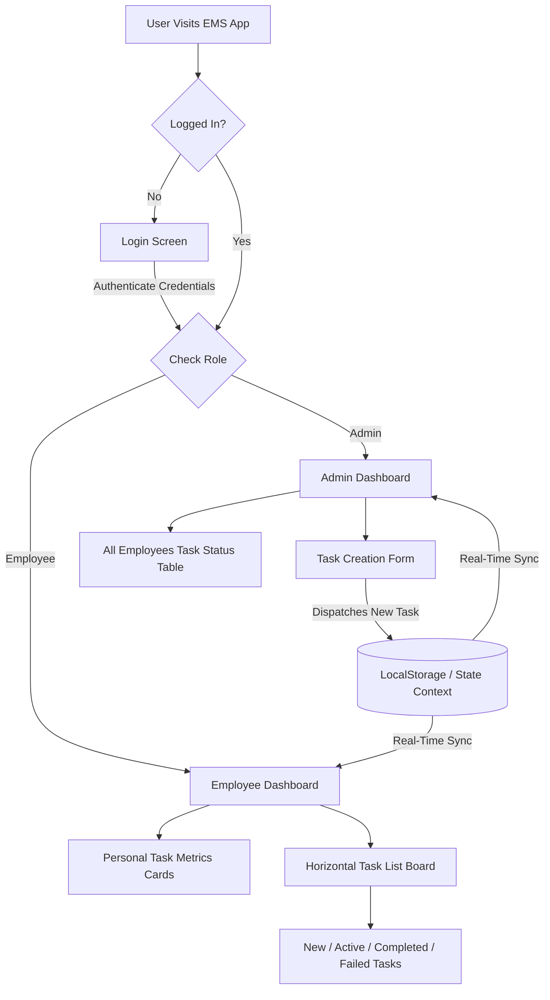

# 🏢 Employee Management System (EMS)

[](https://react.dev/)
[](https://vitejs.dev/)
[](https://tailwindcss.com/)
[](LICENSE)
[](http://makeapullrequest.com)

> A modern, role-based task delegation and employee management dashboard built with **React 19**, **Tailwind CSS v4**, and **Vite**.

---

## 📑 Table of Contents

- [Overview](#-overview)
- [Key Features](#-key-features)
- [Demo Credentials](#-demo-credentials)
- [Tech Stack](#-tech-stack)
- [System Architecture & Workflow](#-system-architecture--workflow)
- [Project Structure](#-project-structure)
- [Getting Started](#-getting-started)
- [Roadmap & Upcoming Features](#-roadmap--upcoming-features)
- [Contributing](#-contributing)
- [License](#-license)
- [Author](#-author)

---

## 🌟 Overview

The **Employee Management System (EMS)** is an intuitive web dashboard designed to bridge communication and task management between team leads/administrators and team members. 

Built with performance and user experience in mind, EMS allows administrators to seamlessly assign and monitor tasks across departments, while giving employees a personalized dashboard to track, accept, and complete work in real time. All data persists locally using browser storage, simulating a seamless full-stack experience right out of the box.

---

## ✨ Key Features

### 🔐 1. Role-Based Authentication
- Multi-user authentication separating **Admin** and **Employee** roles.
- Persistent session handling using React Context API and browser `localStorage`.
- Secure logout mechanism clearing session state seamlessly.

### 👑 2. Administrator Dashboard
- **Task Assignment Engine:** Create and assign tasks with Title, Due Date, Category, and Detailed Descriptions to specific team members.
- **Team Progress Monitor:** High-level overview table displaying each employee's real-time task distribution:
  - 🆕 New Tasks
  - ⚡ Active Tasks
  - ✅ Completed Tasks
  - ❌ Failed Tasks
  - 📊 Total Tasks Assigned

### 👨‍💻 3. Employee Dashboard
- **Personalized Metrics Overview:** Dynamic status summary cards highlighting task statistics.
- **Interactive Task Board:** Horizontal scrollable card system categorized by status:
  - **New Tasks:** Freshly assigned deliverables pending acknowledgement.
  - **Active Tasks:** In-progress assignments.
  - **Completed Tasks:** Archived record of fulfilled duties.
  - **Failed Tasks:** Overdue or missed benchmarks.

### 💾 4. Zero-Config Data Persistence
- Pre-seeded realistic demo data for immediate testing.
- Live state synchronization between the Context layer and browser `localStorage`.

---

## 🔑 Demo Credentials

Test the application instantly using the pre-configured credentials:

| Role | Email | Password | Access Level |
| :--- | :--- | :--- | :--- |
| **Admin** | `admin@example.com` | `admin123` | Full administrative control & task creation |
| **Employee 1** | `employee1@example.com` | `employee1` | View & manage assigned tasks (Amit) |
| **Employee 2** | `employee2@example.com` | `employee2` | View & manage assigned tasks (Sneha) |
| **Employee 3** | `employee3@example.com` | `employee3` | View & manage assigned tasks (Ravi) |

---

## 🛠️ Tech Stack

| Category | Technology | Description |
| :--- | :--- | :--- |
| **Frontend Framework** | [React 19](https://react.dev/) | Component-driven UI architecture with hooks |
| **Build Tool** | [Vite 7](https://vitejs.dev/) | Next-generation frontend tooling with instant HMR |
| **Styling** | [Tailwind CSS v4](https://tailwindcss.com/) | Modern utility-first CSS framework |
| **State Management** | React Context API | Centralized authentication and state dispatch |
| **Storage** | LocalStorage API | Client-side persistent data modeling |
| **Code Quality** | ESLint | Code linting and adherence to best practices |

---

## 🏗️ System Architecture & Workflow



---

## 📂 Project Structure

```text
ems/
├── public/                 # Static assets
├── src/
│   ├── components/
│   │   ├── Auth/
│   │   │   └── Login.jsx           # Login interface with credential verification
│   │   ├── Dashboards/
│   │   │   ├── AdminDashboard.jsx  # Admin portal wrapper
│   │   │   └── EmployeeDashboard.jsx # Employee portal wrapper
│   │   ├── Tasks/
│   │   │   ├── ActiveTask.jsx      # Active task card component
│   │   │   ├── CompletedTask.jsx   # Completed task card component
│   │   │   ├── FailedTasks.jsx     # Failed task card component
│   │   │   ├── NewTasks.jsx        # New task card component
│   │   │   └── TaskList.jsx        # Horizontal scroll container for tasks
│   │   └── others/
│   │       ├── AllTask.jsx         # Employee task overview table for Admin
│   │       ├── Header.jsx          # Header with user greeting & logout
│   │       ├── Loading.jsx         # Loading spinner fallback
│   │       ├── TaskCreation.jsx    # Task creation form for Admin
│   │       └── TaskListNumbers.jsx # Statistics counter cards
│   ├── context/
│   │   └── AuthProvider.jsx        # Global authentication & data context
│   ├── utils/
│   │   ├── LocalStorage.jsx        # LocalStorage helpers
│   │   ├── auth.jsx                # Auth helper utilities
│   │   └── testData.js             # Initial mock data for employees & admins
│   ├── App.css
│   ├── App.jsx                     # Root application component & role router
│   ├── index.css                   # Global styles & Tailwind imports
│   └── main.jsx                    # Application entry point
├── eslint.config.js        # ESLint configuration
├── index.html              # HTML entry template
├── package.json            # Project dependencies and scripts
├── vite.config.js          # Vite configuration
└── README.md               # Project documentation
```

---

## 🚀 Getting Started

Follow these steps to run the project locally on your machine:

### Prerequisites

- [Node.js](https://nodejs.org/) (version `18.x` or higher recommended)
- `npm` (comes bundled with Node.js) or `yarn` / `pnpm`

### Installation

1. **Clone the repository:**
   ```bash
   git clone https://github.com/VanshPahwaa/ems.git
   cd ems
   ```

2. **Install dependencies:**
   ```bash
   npm install
   ```

3. **Start the development server:**
   ```bash
   npm run dev
   ```

4. **Open in browser:**
   Navigate to `http://localhost:5173` (or the URL shown in your terminal).

### Available Scripts

- `npm run dev` — Starts the Vite development server with Hot Module Replacement (HMR).
- `npm run build` — Bundles production-optimized assets into the `dist/` directory.
- `npm run preview` — Locally previews the production build.
- `npm run lint` — Runs ESLint to check for code quality and syntax issues.

---

## 🗺️ Roadmap & Upcoming Features

- [ ] **Backend API:** Connect to a REST / GraphQL backend with Express.js and MongoDB / PostgreSQL.
- [ ] **Secure Authentication:** Implement JWT tokens and hashed passwords (bcrypt).
- [ ] **Drag & Drop Kanban Board:** Allow employees to move tasks between stages visually.
- [ ] **Email & Push Notifications:** Alert employees when new tasks are assigned or deadlines approach.
- [ ] **Analytics & Charts:** Interactive visual reports using Chart.js or Recharts.
- [ ] **Dark / Light Mode Toggle:** Theme customizer for enhanced accessibility.

---

## 🤝 Contributing

Contributions, issues, and feature requests are welcome! Feel free to check out the [issues page](https://github.com/VanshPahwaa/ems/issues).

1. **Fork** the repository
2. **Create** your feature branch: `git checkout -b feature/AmazingFeature`
3. **Commit** your changes: `git commit -m 'Add some AmazingFeature'`
4. **Push** to the branch: `git push origin feature/AmazingFeature`
5. **Open** a Pull Request

---

## 📄 License

This project is licensed under the **MIT License** - see the [LICENSE](LICENSE) file for details.

---

## 👤 Author

**Vansh Pahwa**

- GitHub: [@VanshPahwaa](https://github.com/VanshPahwaa)
- Repository: [ems](https://github.com/VanshPahwaa/ems)

⭐ *If you find this project useful or interesting, please consider giving it a star on GitHub!*
